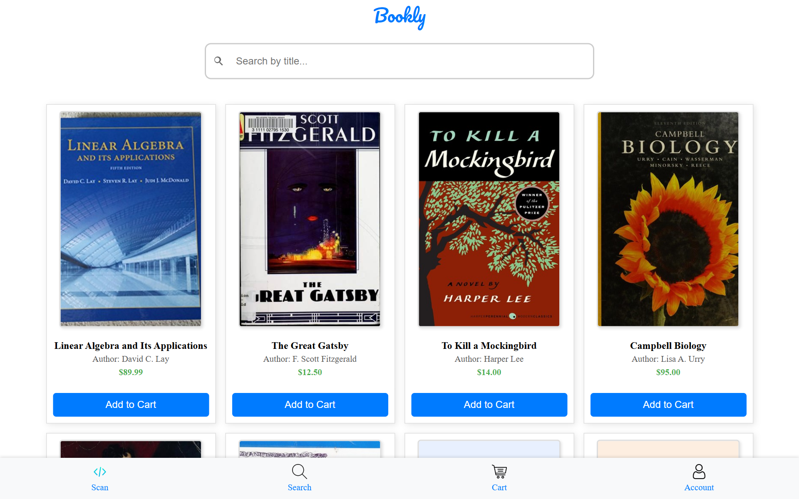
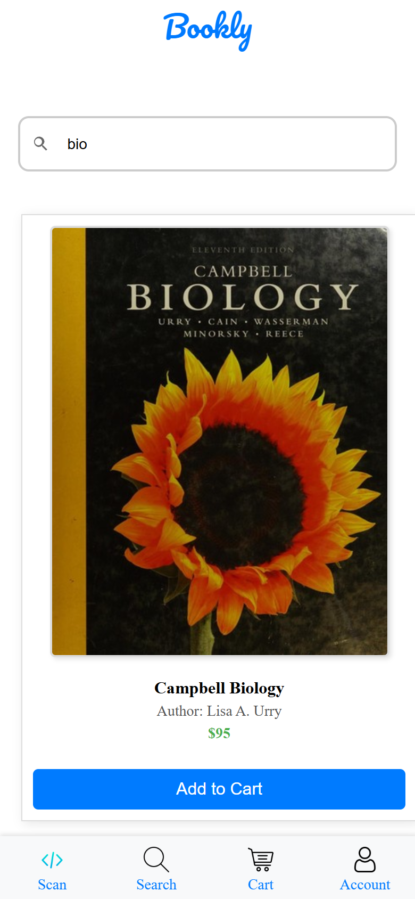
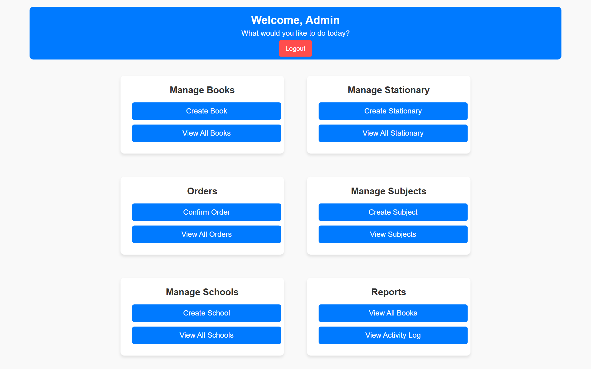

# Bookly

**A school textbook and stationery ordering platform built with Django.**

Parents pick their child's school and subjects, Bookly fills the cart with the required books and supplies, and each order gets a QR code that staff scan at pickup to confirm payment.




## Features

**For parents and students**
- Browse the school's catalog of textbooks and stationery, with cover images and prices
- Live search that updates results as you type (AJAX requests to a JSON endpoint)
- Add every required item for a set of subjects in one step
- Shop as a guest: the cart is kept in the session and merged into the account at login
- Cart grouped by subject, with AJAX quantity updates and a running total
- Checkout creates the order, generates a QR code, and emails a confirmation through Amazon SES

**For school staff**
- Custom admin dashboard behind a superuser-only login protected by reCAPTCHA
- Manage books (by ISBN), stationery, schools, and subjects
- View paid orders; scanning an order's QR code opens it so staff can mark it paid at pickup

<p align="center">
  
  &nbsp;&nbsp;
  
</p>



## How it works

```
Parent ──> Django views ──> PostgreSQL (schools, subjects, books, orders)
                │
     checkout   ├──> qrcode ──> Cloudflare R2 (S3 API via boto3) ──> QR image URL stored on the order
                └──> Amazon SES SMTP ──> order confirmation email with the QR code

Staff scan QR ──> /view_order/<id> ──> mark order paid
```

- **Data model:** a custom `User` model that signs in with email and belongs to a `School`. Each `School` has `Subject`s, and `Book`s and `Stationary` items are linked to subjects many-to-many. Orders use through tables (`OrderBook`, `OrderStationary`) to store per-item quantities.
- **Cart:** a single `CartItem` table uses Django's `GenericForeignKey`, so books and stationery share one cart.
- **Security:** all secrets come from environment variables. Production uses secure session and CSRF cookies, trusted CSRF origins, and reCAPTCHA on the admin login.
- **Static files:** served by WhiteNoise with compressed, hashed filenames.

## Project structure

```
Bookly/      Project settings, URL routes, and storefront/cart/checkout views
Auth/        Data models (users, schools, subjects, books, stationery, orders, carts) and catalog/search views
BookPanel/   Custom admin dashboard views and forms
templates/   Storefront (Auth/) and admin (Admin/) templates
```

## Running locally

```bash
git clone https://github.com/VarindraSeegobin/Bookly.git
cd Bookly
python -m venv venv
source venv/bin/activate        # Windows: venv\Scripts\activate
pip install -r requirements.txt
cp .env.example .env            # then fill in the values
python manage.py migrate
python manage.py createsuperuser
python manage.py runserver
```

The storefront runs at `http://127.0.0.1:8000/` and the staff dashboard at `/custom-admin/login/`.

For quick local testing you can set `POSTGRESQL_CONNECTION_STRING=sqlite:///db.sqlite3` instead of a Postgres URL. Checkout needs Cloudflare R2 and SES credentials, because it uploads the QR code and sends the confirmation email.

## Environment variables

| Variable | Purpose |
| --- | --- |
| `SECRET_KEY` | Django secret key |
| `DJANGO_DEBUG` | Set to `False` in production |
| `POSTGRESQL_CONNECTION_STRING` | Database URL (parsed by `dj-database-url`) |
| `EMAIL_ID`, `EMAIL_PW` | Amazon SES SMTP credentials |
| `RECAPTCHA_PUBLIC_KEY`, `RECAPTCHA_PRIVATE_KEY` | Google reCAPTCHA keys for the admin login |
| `CLOUDFLARE_ACCESS_KEY`, `CLOUDFLARE_SECRET_KEY` | R2 API token |
| `CLOUDFLARE_ENDPOINT`, `CLOUDFLARE_REGION` | R2 S3-compatible endpoint and region |
| `CLOUDFLARE_FIND_ENDPOINT` | Public base URL for uploaded QR images |
| `QR_CODE_BASE_URL` | Base URL encoded in each order's QR code |

## Tech stack

Python · Django 5.1 · PostgreSQL · JavaScript (fetch/AJAX) · HTML/CSS · Cloudflare R2 (boto3) · Amazon SES · qrcode/Pillow · django-recaptcha · WhiteNoise · Gunicorn

The screenshots above show sample data running locally.
